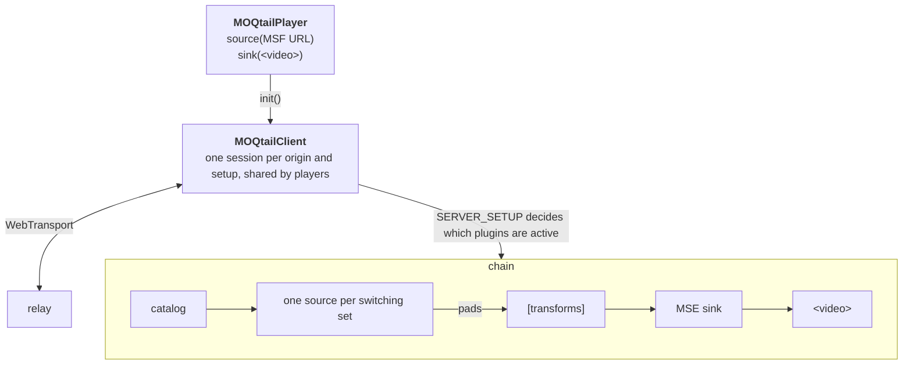

# How the player works

`MOQtailPlayer` turns an MSF URL into playback. It has no fixed pipeline. Like GStreamer, it builds a chain of elements that fits the tracks the catalog lists and the sink you give it. `<moqtail-video>` is the same player inside a `<video>` element, with the default plugins installed.

## Elements and pads

The chain has three kinds of element. A source requests tracks and writes what arrives. A transform changes it, for example by decoding it. A sink plays it.

Elements connect through pads. A source pad belongs to the element that writes, a sink pad to the element that reads, and a connection between them is a short queue of 32 items, delivered in order. When a sink falls behind, the queue fills and the writer waits, so pressure travels back up the chain. A pad carries:

- **packets**: the payload of one object, with its location and properties;
- **frames**: a decoded `VideoFrame` or `AudioData`;
- **properties**: what the next element needs to know about the media, such as the MIME type, the init data, the decoder configuration or the target latency;
- **events**, in order with the packets: a discontinuity after a seek or a gap, and the end of the stream.

Signals skip the queue: a seek travels upstream to the source at once, and a flush travels downstream.

Every pad has capabilities: its packaging (`cmaf`, `loc`, `raw`), its role (`video`, `audio`), and optionally a codec, a MIME type, an event type, or the thread it lives on. An element definition says which capabilities it accepts on its sink pads and which it makes on its source pads. That is all the player uses to connect elements.

## Building the chain

You declare the ends before `init()`: `source()` with an MSF URL, optional `transform()` calls, and `sink()` with a `<video>`, a `<canvas>` or a sink definition. `init()` then connects, keeps the plugins the relay accepted, and picks a source element for each URL.

**Picking an element.** For each track, the candidates are, in order: the definitions you pass to `registerElement()`, the elements of the active plugins, then the built-in ones. Each source definition has a `probe` that says whether it handles the track. Among those that accept it, the lowest `priority` wins (100 by default), then the earliest. So your element wins a tie with a plugin's, and both win a tie with a built-in one.

**Routing pads.** When a source creates a pad, the player sends it to the first declared transform after it that accepts it, or else to every sink that accepts it. If nothing accepts it, the player loads the fewest transforms that make it acceptable, for that pad alone. That is how `.sink(canvas)` gets a WebCodecs decoder in front of it: the built-in `webcodecs` transform takes a `loc` pad and makes a `raw` one, which the canvas sink accepts. A pad that no element can take raises a `PAD_UNLINKED` warning.

**Finishing.** Each top-level source says when it has made all its pads. The player then tells the sinks, and `init()` resolves once they are ready. After that, `play()`, `pause()` and `seek()` go to the sink, and the player's state follows it.

## The catalog element

The catalog element is the built-in source for a track named `catalog`. It subscribes to the catalog track at the highest priority, waits for the first catalog (`catalogTimeoutMs`, 10 seconds by default), and keeps applying updates after that. [Catalogs and packaging](/guide/concepts/media#what-the-player-reads-from-it) describes what it reads.

It does not decide alone what plays. Before it loads anything, it asks the chain how each track would reach a declared sink:

- A switching set no sink can reach is dropped. A catalog can offer the same content in several packagings under one `altGroup` and `lang`, which makes one set per packaging. Of those sets, it keeps the ones that need the fewest loaded transforms, then those whose element has the lowest priority. That is why `.sink(video)` plays CMAF or LOCMAF and `.sink(canvas)` plays LOC when a catalog offers both.
- Each element on the way can refuse a rendition through its `supports()` check: the MSE sink asks `MediaSource.isTypeSupported`, and `webcodecs` asks `isConfigSupported`. A refused rendition leaves its set, and a set left empty gives way to the next one with the same role.

It then loads one source for the video set and one for the audio set, and one for each event timeline you opted into with `eventTimelines`. A media timeline loads when a source first needs it, to seek or to map times. When an active plugin offers a switch source that accepts a set, as `ssts()` does, that source wraps the one the probe picked. Later catalog updates go to the sources whose set changed, and a role whose source lost all its tracks gets a new source.

## Sources and renditions

A media source plays one switching set on one source pad. On a live stream it subscribes from the start of the next group. On demand it fetches from the start. With ranges in the URL, it requests just those. Its subscriptions run at priority 128, below the catalog.

It plays one rendition at a time and switches between them at group boundaries, where the new track can be decoded from its first object. By default a switch is a new SUBSCRIBE. With the `switchFrom` option (the `switch-from` attribute of `<moqtail-video>`), the new SUBSCRIBE carries SWITCH_FROM, and the relay stops the old track where the new one starts. In a fast switching set, a ladder of tracks that differ only in `keyframeSpacing` counts as one rendition. A switch enters the ladder at the track whose next switch point comes first, then moves up to the track with the longest GOP.

## Sinks

The **MSE sink** (`mse`) is what `.sink(video)` adds. It takes `cmaf` pads, from CMAF or LOCMAF sources, and appends them to a `MediaSource`, or to a `ManagedMediaSource` where the browser has one, as Safari does. It plays live and on demand, seeks, and limits live seeking to the catalog's accessible window.

The **playout sink** (`playout`) is what `.sink(canvas)` adds. It takes `raw` pads of decoded frames, draws the video on the canvas, and plays the audio through an AudioWorklet once the page allows audio. When the tracks share the epoch clock, as LOC timestamps without a timescale do, it keeps the video in sync with the audio. It plays live streams only and can't seek back.

## Built-in elements

| Element         | Kind      | Takes                                  | Makes                                                                     |
| --------------- | --------- | -------------------------------------- | ------------------------------------------------------------------------- |
| `catalog`       | source    | the `catalog` track                    | no pad: it loads the other sources                                        |
| `cmaf`          | source    | unencrypted CMAF video and audio       | a `cmaf` pad                                                              |
| `locmaf`        | source    | unencrypted LOCMAF 0.3 video and audio | a `cmaf` pad, of rebuilt CMAF chunks; priority 90, so it wins over `cmaf` |
| `loc`           | source    | unencrypted LOC video and audio        | a `loc` pad                                                               |
| `mediatimeline` | source    | media timeline tracks                  | no pad: it maps media time, locations and wallclock time                  |
| `saptimeline`   | source    | the CMSF SAP event timeline            | records, sent with the `timelineevent` event                              |
| `webcodecs`     | transform | a `loc` pad                            | a `raw` pad of decoded frames                                             |
| `mse`           | sink      | `cmaf` pads                            |                                                                           |
| `playout`       | sink      | `raw` pads                             |                                                                           |

You don't name the sources and the transform: the probe and the router find them. The sinks come from `sink()`.

## Negotiation

Plugins run in two phases around the SETUP exchange. In the player's constructor, each plugin's `setup` hook adds the SETUP parameters it needs, or drops the plugin. Two plugins that set one parameter to different values fail with `UNSUPPORTED_ORIGIN`. After the relay's SERVER_SETUP arrives, each plugin's `negotiated` hook decides whether it is active. An inactive plugin offers nothing, although its parameters were already sent.

`ssts()` shows why. It offers its SSTS algorithms in SETUP, and it is active only if the relay answers with one of them. Only then does the catalog wrap the media switching sets in SSTS sources. Against a relay without SSTS, the same player plays as if the plugin were not there.

## One session per page

Every player on a page shares one `MOQtailClient`. The first player to connect creates it, and the last one to leave disconnects it. Sharing needs the players to agree: the same origin, and the same client options, which include the SETUP parameters their plugins add. While the client is open, a player that wants another origin or other options fails with `UNSUPPORTED_ORIGIN`.

When the session is lost, the client is recreated for every player at once, with backoff, up to `reconnectAttempts` times (5 by default). The players move to `reconnecting` and back. A GOAWAY from the relay moves the session to the address it names. An element's `context.client` is always the current client, so an element that listens to the client listens again on the player's `client` event after a reconnect.

## The worker

With `preferWorker`, which is on by default, the player starts a worker of its own. Each element definition says, through `threads`, whether its heavy part, its engine, may run there. The player moves it there when the worker has what the engine needs: `webcodecs` decodes in the worker when the worker has the decoders, and `playout` draws on the canvas from the worker when every pad it plays comes from there. Then decoded frames never reach the main thread.

The API is the same either way. A canvas the worker draws on stays with that worker, so each player needs a new `<canvas>`. If the worker can't start, for example because the page's Content Security Policy blocks its script, everything runs on the main thread. [Run the player in a worker](/ts/player/worker) covers your own engines.

## Controllers

Two controllers act on live streams while they play. The player attaches them once a negotiated stream is live and detaches them when it turns on-demand or the player is destroyed.

The **buffer controller** holds the latency. The built-in `liveBuffer()` reads the target from the catalog's `targetLatency` or `buffers`, or uses its own (1 second by default). It measures latency against wallclock time when the timeline has it, and by the forward buffer otherwise. It speeds playback up a little when behind, slows it down when ahead or close to a stall, and jumps when the buffer is far past its goal. See [Tune live latency](/ts/player/latency).

The **ABR controller** picks the video rendition. The built-in `abr()` decides every 500 ms with a small neural network whether to step down, stay, step up or probe. To probe, it fetches recently received objects again at priority 200, below live media, to see whether the link has room for the next rendition. The player detaches it while a source switches by itself, as SSTS sources do, and while you have picked a rendition by hand. See [Adaptive bitrate](/ts/player/abr).

Only the first active buffer controller and the first active ABR controller are used. `liveBuffer()` and `abr()` have priority `Infinity`, so any other buffer or ABR controller wins over them. `MOQtailPlayer` installs no plugins, so it has no controllers until you list them. `<moqtail-video>` installs both, unless its `config.plugins` lists others.

## Plugins and features

A plugin bundles features with the SETUP parameters they need, so a protocol extension or a controller is one entry in `plugins`. It can offer these features:

- `element`: a source, transform or sink that joins the candidates for selection;
- `switch-source`: a source that wraps the source of each media switching set it accepts;
- `buffer-controller` and `abr-controller`: the controllers above.

`ssts()`, `liveBuffer()` and `abr()` are the built-in plugins. [Write plugins and elements](/ts/player/plugins) shows how to write one.

## Interfaces elements provide

Besides its pads, an element can declare optional interfaces in `provides`, which the player and other elements look for:

- `MEDIA_SOURCE`: a source that plays a switching set. It lists its renditions, switches to one, sets which ones ABR may choose from, and takes new tracks from catalog updates. `player.mediaSources` and the ABR controller work through it.
- `MEDIA_SINK`: a sink that drives a display. It has the media element's clock, buffer and state, plays, pauses, seeks and sets the playback rate. The player's `play()`, `pause()` and `seek()` and the buffer controller work through it.
- `ABR`: a media source that switches among its selected renditions by itself, so no ABR controller attaches to it.

An element gets a context when it starts. Through it, it reaches the player's events and options, the current client, its tracks and the catalog, and the worker when it may use one. It can also probe for and load other elements, as the catalog and SSTS sources do.

## Related

- [Use MOQtailPlayer](/ts/player/player)
- [Write plugins and elements](/ts/player/plugins)
- [Catalogs and packaging](/guide/concepts/media)
- [`MOQtailPlayer`](/ts/api/player/classes/MOQtailPlayer) and [`ElementContext`](/ts/api/player/interfaces/ElementContext) in the API reference
