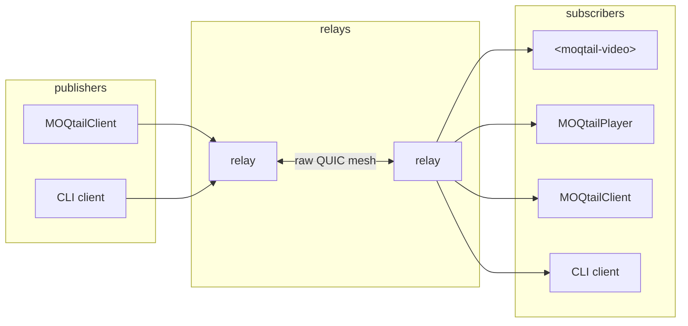
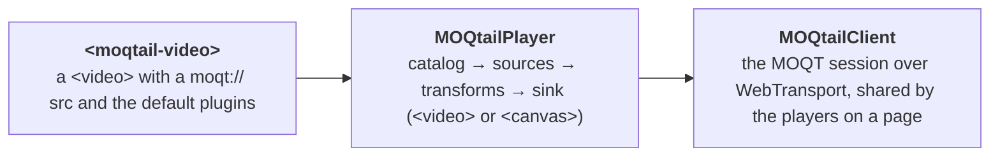

# What is MOQtail?

MOQtail is an open-source implementation of Media over QUIC Transport (MOQT), the IETF protocol for sending live and on-demand media over QUIC. It has a relay, a TypeScript library for browsers, and Rust tooling. All of them follow `draft-ietf-moq-transport-22`.

## The pieces

**The relay** (`apps/relay`) forwards MOQT between publishers and subscribers. It accepts WebTransport and raw QUIC on one UDP port, caches what it forwards, and can join other relays in a mesh. It ships as the container image `ghcr.io/moqtail/relay`. See the [relay overview](/relay/).

**The `moqtail` package** on npm is the browser side, in three layers, each built on the one below it:

- `MOQtailClient` is a MOQT session over WebTransport. It subscribes, fetches and publishes.
- `MOQtailPlayer` reads a catalog and plays its tracks on a `<video>` or a `<canvas>`.
- `<moqtail-video>` is a `<video>` element that takes a `moqt://` URL and sets up the player itself.

See the [TypeScript library](/ts/).

**The Rust crate `moqtail`** on crates.io holds the draft-22 wire models (control messages, data streams, parameters, properties and catalogs) and the transport handlers the relay is built on. It is under active development, so its API changes between releases. Its `client` and `relay` modules are empty placeholders.

**The CLI test client** (`apps/client`) is a Rust program that publishes, subscribes, fetches and discovers namespaces on a relay, over WebTransport or raw QUIC. The [relay tutorial](/relay/tutorial) uses it.

**The demos** use the public relay at `relay.moqtail.dev`:

- [player.moqtail.dev](https://player.moqtail.dev) plays streams with `<moqtail-video>` in a Video.js skin, and publishes your camera or screen. Its source is `apps/client-js`.
- [meet.moqtail.dev](https://meet.moqtail.dev) is a video call built on `MOQtailClient`. Its source is `apps/meet`.

## How they fit together

A publisher connects to a relay and announces a namespace or publishes tracks. A subscriber connects to a relay, often a different one, and asks for a track by name. The relay subscribes to the publisher once per track and sends each object on to every subscriber, keeping recent groups in a cache for later requests. Relays in a mesh tell each other which namespaces they can reach, so a request finds its publisher across several of them.

Browsers connect over WebTransport. Native clients pick WebTransport or raw QUIC, and relays talk to each other over raw QUIC. The relay serves all of them on the same port.

In the browser, the layers of the `moqtail` package stack like this:

The concept pages explain each part: [MOQT in brief](/guide/concepts/moqt), [transports](/guide/concepts/transports), [catalogs and packaging](/guide/concepts/media), [how the relay forwards](/guide/concepts/relay) and [how the player works](/guide/concepts/player).

## Supported drafts

Full means the piece implements the draft, and Partial means it leaves out what the notes list. A dash means the draft asks nothing of that piece. For example, the relay forwards objects without reading their payload, so the media formats need nothing from it.

| Draft                                                                                                                        | Relay | Browser library | Notes                                                                                                                                                                  |
| ---------------------------------------------------------------------------------------------------------------------------- | ----- | --------------- | ---------------------------------------------------------------------------------------------------------------------------------------------------------------------- |
| [MOQ Transport](https://datatracker.ietf.org/doc/draft-ietf-moq-transport/22/), `draft-ietf-moq-transport-22`                | Full  | Full            | Protocol `moqt-22`. The browser library connects over WebTransport only, since browsers can't open raw QUIC connections.                                               |
| [Relay Clustering](https://datatracker.ietf.org/doc/draft-lcurley-moq-cluster/), `draft-lcurley-moq-cluster`                 | Full  | –               | Between relays. Off unless the relay sets `hop_id`.                                                                                                                    |
| [Sender-Side Track Switching](https://wilaw.github.io/moqt-ssts/draft-wilaw-moq-moqt-ssts.html), `draft-wilaw-moq-moqt-ssts` | Full  | Full            | The draft is not adopted yet, so it is off by default: the relay needs `ssts_enable`, and the player needs the `ssts()` plugin.                                        |
| [MOQT Streaming Format](https://datatracker.ietf.org/doc/draft-ietf-moq-msf/), `draft-ietf-moq-msf`                          | –     | Partial         | Reads catalogs whose `version` is `draft-01` or `draft-02`. No authorization tokens, content protection, captions or switching the audio language during playback yet. |
| [CMAF Streaming Format](https://datatracker.ietf.org/doc/draft-ietf-moq-cmsf/), `draft-ietf-moq-cmsf`                        | –     | Partial         | No content protection yet.                                                                                                                                             |
| [LOCMAF](https://datatracker.ietf.org/doc/draft-einarsson-moq-locmaf/), `draft-einarsson-moq-locmaf`                         | –     | Partial         | Unencrypted tracks of LOCMAF version 0.3 only.                                                                                                                         |
| [Low Overhead Media Container](https://datatracker.ietf.org/doc/draft-ietf-moq-loc/), `draft-ietf-moq-loc`                   | –     | Partial         | Unencrypted tracks only, played live on a `<canvas>`.                                                                                                                  |
| [Fast Switching](https://datatracker.ietf.org/doc/draft-ugur-moq-fast-switching/), `draft-ugur-moq-fast-switching`           | –     | Full            |                                                                                                                                                                        |
